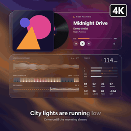

# Cosmo Media Player Pro – App Edition

A media player wallpaper for [Wallpaper Engine](https://store.steampowered.com/app/431960/Wallpaper_Engine/) with **working media buttons**.



The Workshop version of Cosmo Media Player Pro is a *web* wallpaper, and Wallpaper Engine does not let web wallpapers control playback. This edition is an *application* wallpaper, which can – but Wallpaper Engine does not allow application wallpapers on the Workshop, so it is published here instead.

## What it adds over the Workshop version

- **Play / pause, next and previous buttons** that control the current player (Apple Music, Spotify, browsers – anything that shows up in the Windows media overlay)
- **Real audio capture** from your output device: true frequency bands, plus the device name, sample rate and bit depth in the analyzer panel
- **Settings panel inside the wallpaper** (gear button on the card): background, colors, size and position, analyzer, lyrics, clock, and language (Auto / English / 한국어 / 中文)

Everything else is the same as the Workshop version, feature for feature: album-color silk background, glass card with vinyl deck, analyzer panel (stereo spectrum, spectrogram, loudness, tempo), karaoke-style synced lyrics, clock, online track info and the character background.

## New in 1.2.0

- **Silk + Character background** (first option in the settings panel): an illustrated girl with cat-ear headphones listens along over the album-colored silk. Her hair and veil move in the wind; while music plays she closes her eyes and nods to the beat; the highlights flare with every kick; a small equalizer lights up inside her headphone. Wind, nod, blinking, beat light and equalizer each have their own setting.
- **Online track info** (iTunes / Deezer): a panel beside the card with release date, genre, track number, release type, label, featured artists, ISRC, reference tempo and ReplayGain – open it with the "i" button on the card, click the card to close it. Small video thumbnails are replaced by the 1000×1000 album cover when the track is found, and the reference tempo corrects half / double-time BPM readings.
- **More settings**: analyzer layout (full / simple / spectrum only), spectrum style (bars / mirrored / wave / dots), compact player style, vinyl on/off, fixed accent color.
- The settings panel now opens on the right side of the screen.
- The theme when nothing is playing is dark by default; glass blur is off by default.
- Fixes: the analyzer panel and the lyrics hide together with the player; the cover no longer stays on the previous track when a player is slow to send the new one.

## Requirements

- Windows 10 or 11 (64-bit)
- Wallpaper Engine
- Microsoft Edge WebView2 Runtime – already part of Windows 11 and of most Windows 10 installs. If the wallpaper shows a "could not start" message, install it from <https://developer.microsoft.com/microsoft-edge/webview2/>

## Install

1. Download `CosmoMediaPlayerPro-App.zip` from the [latest release](../../releases/latest).
2. Right-click the zip → **Properties** → tick **Unblock** → OK. (Windows marks downloaded files; unblocking first avoids warnings.)
3. Extract it to a folder that will stay where it is, for example `Documents\Wallpapers\CosmoMediaPlayerPro_App`.
4. In Wallpaper Engine, click **Open Wallpaper → Open from File** (bottom left) and pick `project.json` from that folder – or simply drag `project.json` onto the Wallpaper Engine window.

To update, close the wallpaper in Wallpaper Engine, replace the folder's contents with the new release, and open it again. Your settings are kept.

## Using it

- Click the buttons on the card right on the desktop.
- The **gear** button opens the settings panel. Settings are saved automatically.
- The previous-track button is greyed out whenever the player itself has no previous track (for example Apple Music stations).
- The wallpaper follows Wallpaper Engine's pause rules (full-screen applications and so on).

## Good to know

This is a program, not a web page, and it does a few things you should know about before running it:

- It **watches the mouse position and left clicks** while the pointer is over the bare desktop. A wallpaper sits underneath the desktop icons and receives no mouse input from Windows, so this is the only way buttons on a wallpaper can work. Nothing is recorded or sent anywhere.
- It **listens to what your default output device is playing** (loopback capture) to draw the spectrum. The audio is analysed in memory only.
- It **starts a second copy of itself** next to the one Wallpaper Engine starts. Wallpaper Engine takes over the windows of the program it launches, which breaks the WebView2 component that draws the wallpaper; the second copy does the drawing and closes together with the wallpaper.
- Network requests, all of which can be switched off in the settings: the lyrics lookup sends the track title and artist to [lrclib.net](https://lrclib.net) (**Karaoke lyrics**); online track info sends them to iTunes and Deezer (**Online track info**); the update notice asks github.com for the latest release number (**Check for updates**). Nothing else is sent.

Some antivirus products are suspicious of unsigned programs that do the first and third of these. The full source is in this repository if you prefer to check or build it yourself.

## Build from source

Requires the .NET SDK (any recent version; the project targets .NET Framework 4.8).

```
dotnet build src -c Release
```

Then put together the wallpaper folder: the contents of `src\bin\Release\net48`, the `web` folder, `project.json` and `preview.gif`.

## Troubleshooting

- **Black screen with a "could not start" message** – install the WebView2 Runtime (see Requirements).
- **Nothing happens / wallpaper does not appear** – Wallpaper Engine may be paused because another window is in front; show the desktop. A log is written to `%TEMP%\CosmoPlayer.log`.
- **Buttons do not react** – another window or a desktop icon is covering them, or the player does not support that command.

## Character illustration

The girl in the *Silk + Character* background is based on an AI-generated image by **FireDextro**, published on [Civitai](https://civitai.com). For this wallpaper Cosmo Labs extended it on the left, cut it out of its background, retouched it and animated it (wind, nod, blink, lighting).

- The illustration is **not covered by the terms of this repository's source code**. It is used here non-commercially; if you reuse this project, do not use the illustration commercially.
- It depicts Mori Calliope of hololive. hololive and its characters belong to COVER Corp.; this is an unofficial fan work, not affiliated with or endorsed by COVER Corp.
- The extension and the closed-eye frame were generated with the public models the original was made with (JANKU v6.9 and LoRAs, among them *Monster Phantasy*).

## Third-party components

- [NAudio](https://github.com/naudio/NAudio) – MIT License
- [Microsoft Edge WebView2](https://developer.microsoft.com/microsoft-edge/webview2/) – Microsoft Software License
- Lyrics by [LRCLIB](https://lrclib.net)
- Track information from the iTunes Search API and the Deezer API
