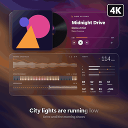

# Wallpaper

Wallpapers for [Wallpaper Engine](https://store.steampowered.com/app/431960/Wallpaper_Engine/) by Cosmo Labs.

| Wallpaper | What it is | Get it |
| --- | --- | --- |
| [Cosmo Media Player Pro – App Edition](CosmoMediaPlayerPro-App) | Media player wallpaper with working play / pause / next / previous buttons, real audio capture, an in-wallpaper settings panel and an animated character background | [Latest release](https://github.com/cosmolabs-kr/Wallpaper/releases/latest) |

The web edition of Cosmo Media Player Pro (no media buttons, installs with one click) is on the Steam Workshop:
<https://steamcommunity.com/sharedfiles/filedetails/?id=3839614863>

## Changes

- **App Edition 1.2.0** – Silk + Character background (wind, nod to the beat, blink, beat light, headphone equalizer), online track info panel and HD covers (iTunes / Deezer), analyzer layouts, spectrum styles, compact player; settings panel opens on the right
- **App Edition 1.1.1** – follows Wallpaper Engine's pause rules (stops drawing while paused)
- **App Edition 1.1.0** – background image, clock options, new analyzer readouts, update notice
- **App Edition 1.0.0** – first release

## Credits

The character illustration in Cosmo Media Player Pro is based on an AI-generated image by FireDextro (Civitai), extended, cut out, retouched and animated by Cosmo Labs. It depicts Mori Calliope of hololive (© COVER Corp.) and is an unofficial, non-commercial fan work; it is not covered by the terms of the source code. Details: [CosmoMediaPlayerPro-App/README.md](CosmoMediaPlayerPro-App/README.md#character-illustration).
